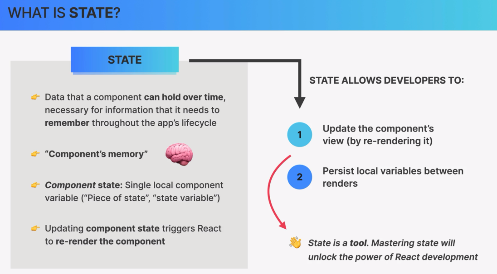
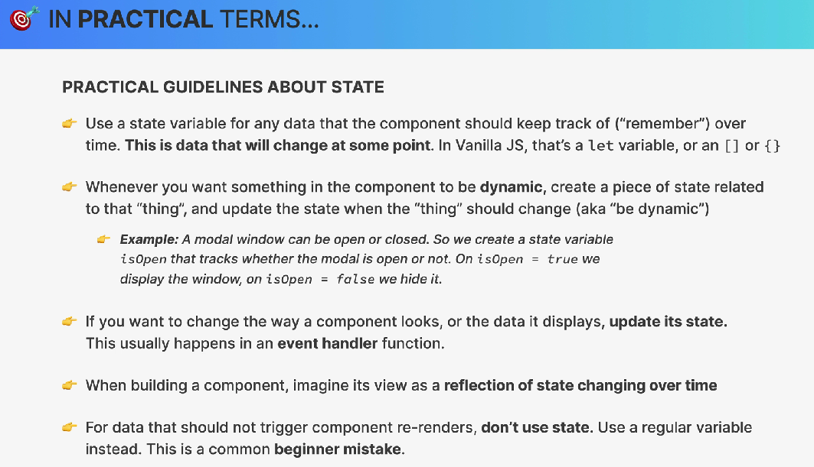

# `useState()`




## 1. `useState` devuelve 2 valores

Cuando hacemos:

``` JSX

const [step, setStep] = useState(1);

```

### `useState(1)` devuelve un arreglo con dos elementos:

    [
    valor actual,
    función para actualizar ese valor
    ]

Por eso usamos destructuring:

``` JSX

const [step, setStep] = useState(1);

```

Equivale conceptualmente a:

``` JSX

const estado = useState(1);

const step = estado[0];
const setStep = estado[1];

```

Así que:

- `step` → contiene el **estado actual**

- `setSte`p → función que permite **actualizar el estado**

- `1` → valor inicial del estado

Por ejemplo:

``` JSX

const [step, setStep] = useState(1);

console.log(step); // 1

```

Y:

``` JSX

setStep(2);

```

le dice a React:

- Quiero que `step` pase a valer `2` y que vuelvas a renderizar este componente.

## 2. ¿Por qué `setStep` es una función?

Porque React necesita que exista una manera controlada de modificar el estado.

No hacemos:

``` JSX

step = 2; // ❌

```

Sino:

``` JSX

setStep(2); // ✅

```

Esto es importante.

Cuando hacemos:

``` JSX

setStep(2);

```

React sabe:

    El estado cambió
        ↓
    Hay que volver a renderizar
        ↓
    El componente se ejecuta nuevamente
        ↓
    step ahora vale 2

## 3. `useState` solamente se puede llamar al inicio del componente

Esta es una regla de los Hooks:

**Los Hooks deben llamarse en el nivel superior del componente.**

Por ejemplo, esto está bien:

``` JSX

function App() {
  const [step, setStep] = useState(1);
  const [isOpen, setIsOpen] = useState(true);

  // ...
}

```

Pero esto está mal:

``` JSX

function App() {
  if (something) {
    const [step, setStep] = useState(1); // ❌
  }
}

```

También:

``` JSX

function App() {
  function algo() {
    const [step, setStep] = useState(1); // ❌
  }
}

```

Y

``` JSX

function App() {
  function algo() {
    const [step, setStep] = useState(1); // ❌
  }
}

```

### ¿Por qué?

Porque React necesita que los Hooks se ejecuten **siempre en el mismo orden en cada render**.

Por ejemplo:

``` JSX

function App() {
  const [step, setStep] = useState(1);
  const [isOpen, setIsOpen] = useState(true);
  const [name, setName] = useState("Pepe");
}

```

React internamente necesita poder asociar:

    Primer useState  → step
    Segundo useState → isOpen
    Tercer useState  → name

Por eso no debemos hacer que un Hook aparezca o desaparezca dependiendo de un `if`.`