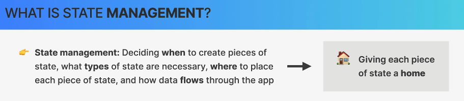
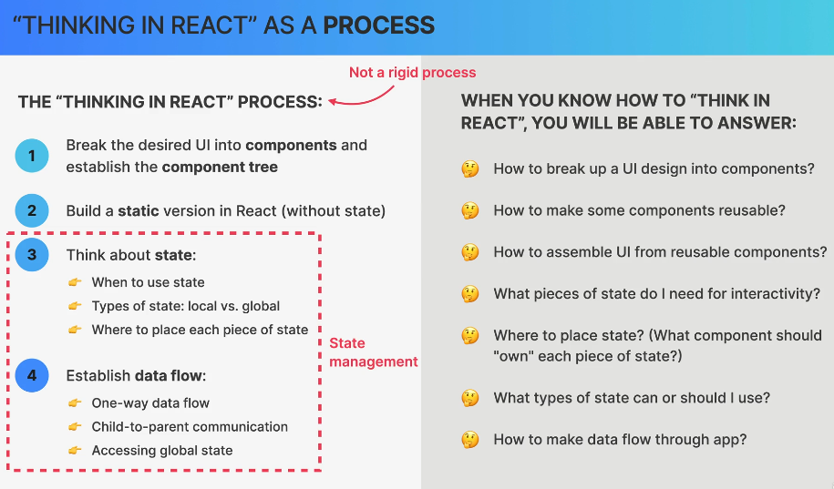
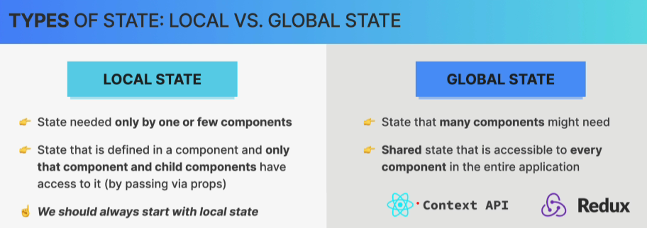
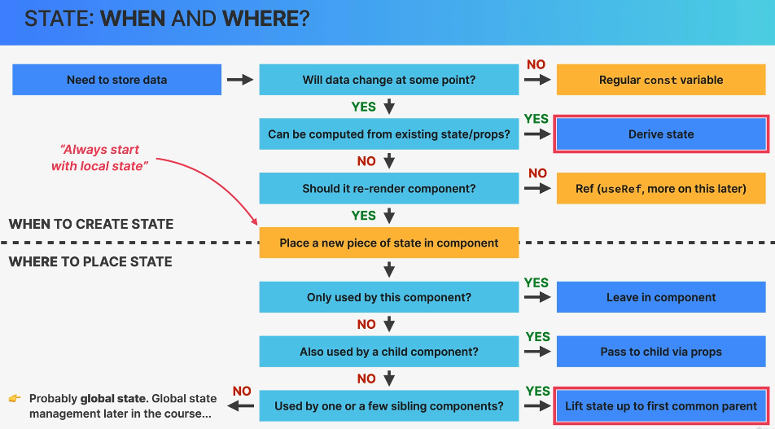

# State Management

Se refiere a que antes de escribir código, se debe decidir cómo dividir la interfaz, qué datos necesita cada parte y cómo se compartirán esos datos.





Al inicio de un proyecto y/o aplicación, en lugar de pensar directamente en archivos, funciones y código, se empieza con estas preguntas:

- **¿Qué componentes necesito?** Se divide la interfaz en piezas independientes.

- **¿Qué componentes puedo reutilizar?** Evitar repetir estructuras y lógica.

- **¿Qué datos necesita recordar la aplicación?** Identificar el estado.

- **¿Dónde debe vivir cada dato?** Buscar el componente propietario adecuado.

- **¿Cómo fluyen los datos?** Decidir qué se pasa mediante `props` y cómo se comunican los componentes.

## 1. ¿Cuándo conviene crear un componente?

- Cuando una parte de la interfaz tiene una responsabilidad clara.

- Cuando se necesita reutilizar en diferentes lugares.

- Cuando tiene lógica propia que conviene aislar.

- Cuando un componente se está volviendo demasiado grande o difícil de entender.

**Nota:** No se necesita crear un componente por cada elemento HTML. Un `<div>` no necesita convertirse automáticamente en un componente.

## 2. Estado: ¿qué datos deben recordarse?

El estado (***state***) es información que React conserva entre renderizados y cuya actualización puede provocar que el componente se vuelva a renderizar.

### Ejemplo:

| Dato | ¿Necesita estado? | Motivo |
|:---| :---:| :--|
| Lista de tareas | Sí | Puede cambiar cuando se crea o se elimina una tarea |
|Texto del formulario | Sí, normalmente | Cambia se mientra se escribe
|Número de tareas pendientes | No necesariamente |Puede calcularse a partir de la lista
|Nombre fijo de la aplicación | No | No cambia
|Si un menú está abierto | Sí, normalmente | La interacción modifica su visibilidad |

**La pregunta importante es:**

- ¿Es necesario recordar este dato entre renderizados y puede cambiar durante el uso de la aplicación?

Si la respuesta es sí, probablemente se necesita un estado, aunque también se debe considerar si el dato ya existe en otro estado o puede obtenerse de `props`.

## 3. Tres categorías que a distinguir para guardar datos

1. **Variable normal**

``` jsx

const appName = "My Tasks";

```

- Usar para valores que no necesitan cambiar como parte de la interacción. Si el valor cambia, esa asignación por sí sola no hace que React vuelva a renderizar.

### 2. Estado (`useState`)

``` jsx

const [count, setCount] = useState(0);

```

- Usar cuando un dato debe persistir entre renderizados y su actualización debe reflejarse en la interfaz.

### 3. Valor derivado

``` jsx

const completedTasks =
  tasks.filter((task) => task.completed).length;

```

- Si se puede obtener un valor a partir de `props` o estado existente, normalmente se debe calcular en lugar de guardarlo por separado.

## 4. Estado local vs. estado global



### Estado local
Es el estado que necesita un componente o un grupo pequeño de componentes.

Ejemplos:

- Si un menú desplegable está abierto.

- El texto que estás escribiendo en un formulario.

- Si un acordeón está expandido.

- La pestaña seleccionada en un panel específico.

### Estado global

Es información que necesitan componentes alejados entre sí y que conviene compartir mediante un mecanismo común.

Por ejemplo, en una tienda online:

- El carrito de compras.

- La información del usuario autenticado.

- Las preferencias globales de la aplicación.

No todo dato compartido tiene que ser global. React permite compartir estado entre componentes sin instalar ninguna biblioteca.

**Importante**

En React, ***estado global*** suele referirse a estado accesible desde muchas partes de la aplicación mediante Context, Redux u otra solución compartida. No significa que todo componente pueda modificarlo arbitrariamente.

## 5. ¿Dónde colocar el estado? 

### El concepto de “state ownership”

La regla práctica es:

Colocar el estado en el componente más cercano que sea ancestro común de todos los componentes que necesitan leerlo o actualizarlo.

Esto se conoce como ***lifting state up*** o elevar el estado.

Ejemplo:

`ProductList` y `Cart` necesitan conocer los productos seleccionados.

- Si solo `ProductList` necesita esos datos, se deja el estado allí.

- Si `ProductList` y `Cart` lo necesitan, se sube a su ancestro común.

- Si muchos componentes distribuidos por la aplicación necesitan acceder a esos datos, se evalúa Context o una solución de estado global.

## 6. Una distinción importante: estado compartido no siempre significa estado global

Hay tres niveles que conviene recordar:

| Situación | Solución inicial |
|:--- | --- |
|Un componente necesita el dato | Estado local
|Varios componentes cercanos necesitan el dato | Elevar el estado y usar props
|Muchos componentes alejados necesitan el dato | Considerar Context o una solución global

Además, no solo existe **estado local y Redux**. Existen otras alternativas y cada una resuelve necesidades diferentes.

Por ejemplo:

- `useState`: estado local y compartido mediante props.

- `useReducer`: actualizaciones con una lógica más estructurada.

- Context API: compartir valores a través del árbol sin pasar props por cada nivel.

- Redux: administrar estado compartido mediante un modelo centralizado y herramientas adicionales.

**Nota:** Siempre empezar por el estado local así se evita añadir complejidad antes de saber que realmente se necesita.

## Resumen

Antes de crear un estado en React, hacer estas preguntas en orden:

- ¿Es un dato que necesito recordar entre renderizados?

- ¿Puede calcularse a partir de props o de otro estado?

- ¿Qué componentes necesitan leerlo o actualizarlo?

- ¿Cuál es su ancestro común más cercano?

- ¿Basta con estado local y props, o existe una necesidad real de compartirlo más ampliamente?

